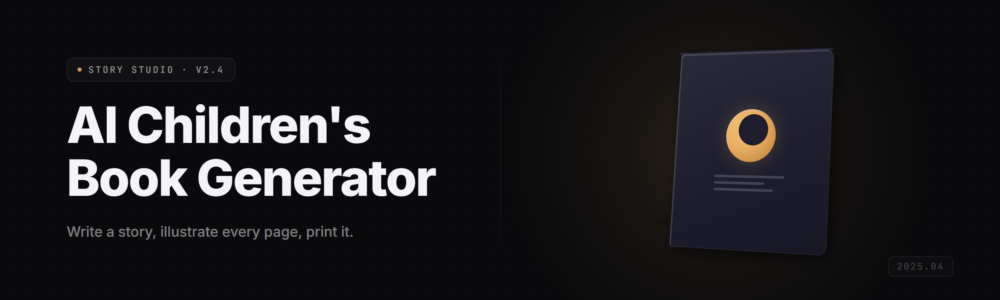

  
  
  

  

  
  
  

---

AI children's book generator for parents and indie authors — turn a one-line idea into an illustrated story with matching text and art, no subscription required.

## Overview

AI children's book generator for parents and indie authors — turn a one-line idea into an illustrated story with matching text and art, no subscription required.

  

## License

[MIT License](LICENSE)

  

